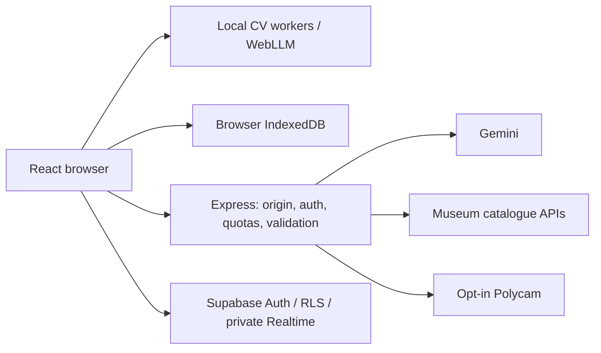

# Architecture

The browser owns interface state (Zustand), asynchronous actions (TanStack Query), CV workers and origin-scoped IndexedDB history. It calls a same-origin `/api` gateway; Vite provides that proxy during development. Supabase Auth, database and private Realtime channels are optional direct browser integrations protected by server-verified sessions and database policies.

## Boundaries

`server/security.ts` checks deployment mode, exact allowed origins, local socket/Host identity when enabled, verified Supabase users, request quotas, concurrency and bounded body parsing. Public liveness/configuration-state routes disclose no credentials. Secrets are configured by the operator; no HTTP route writes them.

`server.ts` retains the structured AI analysis, comparison, restoration, epigraphy, chat and catalogue-reference flows. Provider output is untrusted. Report/map values are escaped before HTML insertion and CSV text is neutralized before quoting. There is no shared global artifact/RAG memory or claimed cloud sync.

`server/photogrammetry.ts` streams bounded photos to temporary disk, verifies raster signatures, cleans up after use and creates user-owned expiring jobs. Provider URLs are restricted to explicit HTTPS hosts, redirects are rejected and model downloads remain authenticated through the API. The browser fetches authorized bytes and passes a local blob URL to its viewer. Polycam is experimental, disabled by default and still requires a compatible account/API.

`supabase/schema.sql` defines a fresh-project schema with private workspace membership, actor-bound annotations and private embeddings. Museum publication requires deliberate museum and room publication. Database tests simulate anonymous/owner/other/member actors in disposable PostgreSQL; hosted Auth/WebSocket settings still require staging verification.

## Product and data separation

This edition is self-hosted. Each deployment configures its own provider accounts and Supabase project. Browser history is stored per origin and browser profile.

Browser history is local to the browser profile, not encrypted or isolated between people sharing that profile. Online actions transmit selected data to the configured providers. Public discovery examples are approximate public locations. Do not insert confidential excavation data into shared/public content.

## Verification limits

Automated tests mock provider boundaries; no key validity test or paid provider workflow is required. CV/WebGL/WebGPU behavior depends on the browser/device and may trigger model/environment downloads. Multi-instance deployments need coordinated quotas and suitable proxy/body/connection limits. The first edition excludes desktop packaging and service-worker shell caching. See the setup and security policies before deployment.
